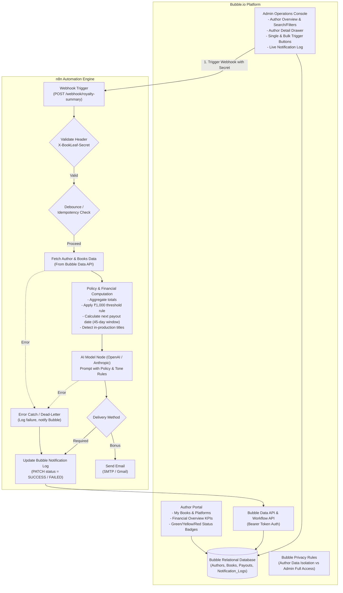

# BookLeaf Publishing — Technical Assignment 2 of 2
## Author Royalty Dashboard & Automated Notification System (Bubble.io + n8n + AI API)
### Master Implementation Plan & System Architecture Specification

---

## 1. Executive Summary & Core Objectives

This project builds an operational author management and royalty communication platform combining:
1. **Bubble.io Web Application:** Serving as BookLeaf's operational frontend and relational database, featuring author self-service dashboards, operations management queues, and granular privacy controls.
2. **n8n Automation Engine:** Serving as the backend workflow orchestrator handling secure webhooks, author data extraction, BookLeaf business logic, AI prompt generation, email delivery, and bidirectional status callbacks.
3. **AI API Integration (OpenAI / Anthropic):** Generating empathetic, accurate, and policy-grounded royalty summary emails reflecting BookLeaf's brand voice and business rules.

---

## 2. End-to-End System Architecture



---

## 3. Bubble Database Design & Relational Schema

### 3.1 Option Sets (Enumerations)
* **`OS_BookStatus`**: `PUBLISHED`, `IN_PRODUCTION`
* **`OS_RoyaltyStatus`**: `GREEN` (Fully Paid), `YELLOW` (Pending within cycle), `RED` (Overdue >90 days or unpublished payout overdue)
* **`OS_NotificationStatus`**: `PENDING`, `SUCCESS`, `FAILED`
* **`OS_UserRole`**: `AUTHOR`, `ADMIN`
* **`OS_TriggerType`**: `MANUAL_SINGLE`, `BULK_OPERATIONS`

### 3.2 Custom Data Types & Field Mapping
To mirror a production-grade relational database and cleanly ingest `bookleaf_sample_data.json`:

#### 1. `User` (Built-in Bubble Type)
* `name` (text)
* `email` (text, unique)
* `role` (Option Set: `OS_UserRole`, default: `AUTHOR`)
* `author_profile` (Type: `Author`)

#### 2. `Author`
* `author_id` (text, e.g. "AUTH001")
* `user_account` (Type: `User`)
* `name` (text)
* `email` (text)
* `phone` (text)
* `city` (text)
* `joined_date` (date)
* `books` (List of `Book`s)
* `total_books` (number, computed / maintained)
* `total_royalty_earned` (number)
* `total_royalty_paid` (number)
* `total_royalty_pending` (number)
* `payout_status` (Option Set: `OS_RoyaltyStatus`)

#### 3. `Book`
* `book_id` (text, e.g. "BK001")
* `author` (Type: `Author`)
* `title` (text)
* `isbn` (text, nullable for in-production)
* `genre` (text)
* `status` (Option Set: `OS_BookStatus`)
* `publication_date` (date, nullable)
* `mrp` (number)
* `author_royalty_per_copy` (number)
* `total_copies_sold` (number)
* `total_royalty_earned` (number)
* `royalty_paid` (number)
* `royalty_pending` (number)
* `last_royalty_payout_date` (date, nullable)
* `print_partner` (text, e.g. "In-House", "Repro India", "Epitome Books")
* `available_on` (List of texts, e.g. "Amazon India", "Flipkart", "BookLeaf Store")
* `royalty_status` (Option Set: `OS_RoyaltyStatus`)

#### 4. `Payout_Record` (History of past disbursements)
* `author` (Type: `Author`)
* `book` (Type: `Book`, nullable if consolidated)
* `amount` (number)
* `payout_date` (date)
* `payout_cycle` (text, e.g. "Q2 2025")
* `reference_id` (text)

#### 5. `Notification_Log` (Audit trail of AI summary dispatches)
* `log_id` (text, unique identifier)
* `author` (Type: `Author`)
* `triggered_by` (Type: `User`)
* `trigger_type` (Option Set: `OS_TriggerType`)
* `status` (Option Set: `OS_NotificationStatus`, default: `PENDING`)
* `generated_email_body` (text)
* `error_message` (text, nullable)
* `triggered_at` (date)
* `completed_at` (date, nullable)
* `n8n_execution_id` (text, nullable)

---

## 4. Bubble Privacy Rules & Security Isolation

A critical requirement of Section A4 is that author users **must never** have read or write access to other authors' financial data or admin logs.

| Data Type | Rule Name | Condition | Permissions |
| :--- | :--- | :--- | :--- |
| **`Author`** | Admin Full Access | `Current User's role is ADMIN` | View all fields, Find in searches, Modify |
| | Author Self Access | `Current User's author_profile is This Author` | View all fields, Find in searches |
| | Others (Public) | Everyone else | No access (uncheck all) |
| **`Book`** | Admin Full Access | `Current User's role is ADMIN` | View all fields, Find in searches, Modify |
| | Author Self Access | `This Book's author's user_account is Current User` | View all fields, Find in searches |
| | Others (Public) | Everyone else | No access |
| **`Notification_Log`** | Admin Full Access | `Current User's role is ADMIN` | View all fields, Find in searches, Modify |
| | Author Self Access | `This Log's author's user_account is Current User` | View all fields, Find in searches |
| | Others (Public) | Everyone else | No access |

---

## 5. Author Portal Architecture (Section A2)

### 5.1 Financial Summary KPI Header
Consolidated across all books owned by the logged-in author:
* **Total Earned:** `Current User's author_profile's books's total_royalty_earned:sum` (Formatted as ₹ currency)
* **Total Paid Out:** `Current User's author_profile's books's royalty_paid:sum`
* **Total Pending:** `Current User's author_profile's books's royalty_pending:sum`

### 5.2 "My Books" Portfolio Table / Grid
A Repeating Group displaying `Current User's author_profile's books`:
* Title, Genre, Status Badge (Published vs In Production), ISBN, Publication Date, MRP, Platform Tags.
* Sales Metrics: Copies sold, Total Earned, Paid, Pending, Last Payout Date.

### 5.3 Dynamic Royalty Status Indicator (Visual Badges)
The UI applies conditional styles based on strict business logic:
* 🟢 **Green (Fully Paid Up):**
  * Expression: `This Book's royalty_pending <= 0`
* 🟡 **Yellow (Pending within Normal Cycle):**
  * Expression: `This Book's royalty_pending > 0` AND (`Current Date - This Book's last_royalty_payout_date:format as days <= 90` OR `This Book's last_royalty_payout_date is empty` AND `Current Date - This Book's publication_date:format as days <= 90`)
* 🔴 **Red (Overdue Royalties):**
  * Expression: `This Book's royalty_pending > 0` AND (`Current Date - This Book's last_royalty_payout_date:format as days > 90` OR (`This Book's last_royalty_payout_date is empty` AND `Current Date - This Book's publication_date:format as days > 90`))

---

## 6. Admin Portal Architecture (Section A3)

### 6.1 Author Overview Table & Filters
* **Search Input:** Dynamic text filtering by `Author's name` or `Author's email`.
* **City Dropdown:** Dynamic options populated from unique cities in database.
* **Payout Status Filter:** Tabs or Dropdown for `All`, `Fully Paid`, `Pending`, `Overdue`.
* **Summary Columns:** Author Name, City, Total Books, Total Earned, Total Pending, Overdue Status Tag, Quick Action button.

### 6.2 Author Detail Drawer / Modal
* Full book portfolio breakdown with individual sales & pending amounts.
* Payout history ledger.
* **"Generate & Send Royalty Summary" Button:**
  1. Creates a new record in `Notification_Log` (`status = PENDING`, `author = Selected Author`, `triggered_at = Current date/time`).
  2. Disables the button and sets a local custom state `is_loading = yes` to provide instant visual feedback.
  3. Triggers the n8n webhook via Bubble API Connector with `author_id`, `log_id`, and `author_email`.
  4. Displays a success notification: *"Royalty summary generation initiated. Check Notification Log below."*

### 6.3 Bulk Operations Trigger
* **"Bulk Trigger for Pending Authors" Button:**
  1. Finds all authors where `total_royalty_pending > 0`.
  2. Displays confirmation modal showing recipient count: *"Are you sure you want to trigger summaries for X authors?"*
  3. Iterates over eligible authors (via Bubble backend workflow on a list) and calls the n8n webhook once per author with debouncing.

### 6.4 Notification & Audit Log Feed
* Real-time repeating group sorted by `triggered_at (descending)`.
* Displays: Author Name, Timestamp, Trigger Type, Status Pill (🟢 Success, 🟡 Pending, 🔴 Failed), Execution Time.
* **"View Generated Email" Modal:** Allows admins to inspect the exact AI-generated output stored in `generated_email_body` and verify accuracy.

---

## 7. n8n Automation Engine Blueprint (Section B & C)

### 7.1 Webhook & Security Architecture
* **Endpoint:** `POST /webhook/royalty-summary`
* **Security Check:** HTTP Request Header `X-BookLeaf-Secret` matched against n8n environment credential. If missing/invalid, return HTTP `401 Unauthorized`.
* **Immediate Response:** Return HTTP `202 Accepted` with `{"status": "queued", "log_id": log_id}` so Bubble never experiences a client-side timeout.

### 7.2 Data Fetching Strategy Justification (Section B, Step 2)
The assignment states: *"n8n pulls the author's complete data — either by querying the Bubble Data API or by receiving the full payload in the webhook. Either approach is acceptable; justify your choice."*

* **Selected Approach: Hybrid Fetch via Bubble Data API**
  * **Justification:**
    1. **Data Freshness & Authority:** Fetching directly from Bubble Data API ensures the workflow always acts on the absolute latest database state, eliminating race conditions or stale client state.
    2. **Payload Hygiene:** Webhook payloads remain lightweight and resilient (passing only `author_id` and `log_id`), preventing payload truncation or serialization issues with complex nested lists.
    3. **Demonstrates Integration Mastery:** Showcases two-way authenticated API interaction (Bubble calling n8n webhook $\rightarrow$ n8n querying Bubble Data API with Bearer token $\rightarrow$ n8n updating Bubble via Data API callback).

### 7.3 Data Transformation & Business Rules (Code Node)
Before sending data to the AI model, a JavaScript Code node processes raw records:
1. Calculates aggregated financial totals: `totalEarned`, `totalPaid`, `totalPending`.
2. Segregates published books vs in-production titles.
3. Computes the **Next Eligible Payout Date** according to BookLeaf's Quarterly Cycle & 45-day window:
   * **Q1 (Jan–Mar sales):** Disbursed by **May 15**
   * **Q2 (Apr–Jun sales):** Disbursed by **Aug 15**
   * **Q3 (Jul–Sep sales):** Disbursed by **Nov 15**
   * **Q4 (Oct–Dec sales):** Disbursed by **Feb 15**
4. Identifies the **₹1,000 Minimum Payout Threshold** rule (e.g. Kavita Deshmukh's ₹840 pending): flags that earnings will safely roll over to the next cycle.

### 7.4 Grounded AI Prompt Engineering
* **Model:** OpenAI (`gpt-4o-mini`) or Anthropic (`claude-3-5-haiku`).
* **System Prompt:**
```text
You are BookLeaf Publishing's Author Communication Copilot.
Generate a warm, transparent, and encouraging royalty summary email to the author based strictly on their verified book and royalty data.

Guidelines:
1. Personalized greeting using the author's name.
2. Clear summary of each published book with title, copies sold, royalty earned, amount paid, and pending balance.
3. Clear consolidated breakdown: Total Earned, Total Paid, Total Pending.
4. Next payout explanation:
   - If pending >= ₹1,000: Explain the next disbursement date based on the 45-day post-quarter schedule.
   - If pending > 0 but < ₹1,000: Empathize and clearly explain the ₹1,000 rollover threshold rule.
   - If pending == 0: Provide warm praise and acknowledgement of all earnings being up to date.
5. In-Production books: If any book is "IN_PRODUCTION", provide an encouraging status update explaining that sales data will begin accumulating once published.
6. Tone: Warm, celebratory, professional, author-first. Sign off as "Warm regards, Team BookLeaf Publishing".
```

### 7.5 Output & Callback Lifecycle
1. **Send Email (Bonus):** Formats HTML email and dispatches via SMTP/Gmail node to `author_email` (or test sandbox).
2. **Update Bubble Notification Log (Required):**
   * Calls Bubble Data API: `PATCH /api/1.1/obj/notification_log/:log_id`
   * Updates fields:
     * `status = "SUCCESS"`
     * `generated_email_body = {{ ai_response }}`
     * `completed_at = {{$now}}`
     * `n8n_execution_id = {{$execution.id}}`

### 7.6 Error Handling & Dead-Letter Routine (Section C)
* All nodes wrapped in n8n `Continue On Fail` or routed through an **Error Trigger**.
* If OpenAI fails, rates limits, or Bubble API drops:
  * A dedicated error handler catches the exception.
  * Sends a callback to Bubble updating the `Notification_Log` record with:
    * `status = "FAILED"`
    * `error_message = {{ $error.message }}`
  * Logs the incident to n8n execution history so operators can replay without losing data.

---

## 8. Handling Planted Edge Cases & Business Logic

| Edge Case | Author in Dataset | Required System Behavior | Handled By |
| :--- | :--- | :--- | :--- |
| **₹1,000 Threshold Rollover** | Kavita Deshmukh (AUTH009) | ₹840 pending is below ₹1,000 minimum. Status is Yellow. AI explicitly notes amount rolls over into Q4 cycle. | Code Node + AI Prompt |
| **Book In Production** | Sneha Patel (AUTH004) | *Bridges We Never Crossed* is in production (ISBN null, 0 sold, 0 earned). UI displays "In Production" badge without null crashes; AI gives status update. | UI Conditionals + AI Prompt |
| **First-Time Payout** | Aditya Roy (AUTH006) | Published book with pending royalties but zero past payouts (`last_payout_date` is null). Correctly calculates days since publication for badge. | Badge Formula + AI Prompt |
| **Overdue Royalties** | Authors with >90 days since last payout | Red badge in UI, flagged as "Overdue" in Admin filters. AI acknowledges delayed cycle and provides reassurance. | UI Filter Logic + AI Prompt |
| **Multiple Books** | Vikram Malhotra, Ananya Iyer | Renders individual book tables + consolidated KPI summaries accurately. | Repeating Group + Aggregate Formula |

---

## 9. Idempotency & Debounce Strategy

1. **Bubble UI Level:**
   * On click of "Generate & Send", the button enters a disabled state immediately (`This button isn't clickable`).
   * A spinner displays on the button until Bubble confirms the webhook trigger.
2. **Bubble Database Level:**
   * Prevents creating a new trigger if an active `Notification_Log` for that author with `status = PENDING` was created in the last 3 minutes.
3. **n8n Level:**
   * The Code node verifies the `log_id`. If the log is already marked `SUCCESS`, execution exits gracefully with a 200 response to prevent redundant emails or AI charges.

---

## 10. Step-by-Step Execution Plan (7-Day Roadmap)

### Day 1: Foundation & Data Ingestion
- [ ] Set up Bubble.io application on the free tier.
- [ ] Define Option Sets (`OS_BookStatus`, `OS_RoyaltyStatus`, `OS_NotificationStatus`, `OS_UserRole`).
- [ ] Create Custom Data Types (`Author`, `Book`, `Payout_Record`, `Notification_Log`).
- [ ] Run automated data converter script to transform `bookleaf_sample_data.json` into clean CSV files.
- [ ] Ingest all 10 Authors and 18 Books into Bubble App Data.

### Day 2: Security & Privacy Rules Configuration
- [ ] Implement Bubble Privacy Rules for `User`, `Author`, `Book`, and `Notification_Log`.
- [ ] Configure Bubble API: Enable Data API and Workflow API under Settings $\rightarrow$ API.
- [ ] Generate Bubble API Token for secure n8n communication.
- [ ] Verify data isolation by testing with sample author credentials.

### Day 3: Author Portal Development
- [ ] Build responsive Author Dashboard layout with header navigation and user profile.
- [ ] Implement Consolidated KPI Cards (Total Earned, Total Paid, Total Pending).
- [ ] Build "My Books" repeating group showing book covers, ISBNs, and platform tags.
- [ ] Implement Green / Yellow / Red conditional status badges on every book card.

### Day 4: Admin Operations Console
- [ ] Build Operations Queue table with dynamic search by Author Name.
- [ ] Implement City and Payout Status (Fully Paid / Pending / Overdue) filters.
- [ ] Create Author Detail slide-out modal displaying author portfolio and financial breakdown.
- [ ] Build Live Notification Log repeating group with status indicators.
- [ ] Wire single trigger button with loading state and debounce protection.

### Day 5: n8n Automation Engine Setup
- [ ] Set up n8n instance (Cloud trial or local Docker with ngrok tunnel).
- [ ] Create Webhook Trigger node with `X-BookLeaf-Secret` header authentication.
- [ ] Add Bubble Data API query node with Bearer token authentication.
- [ ] Implement Code node with financial aggregations and quarterly cycle logic.
- [ ] Connect OpenAI / Anthropic node with BookLeaf grounded system prompt.
- [ ] Connect Callback node to update Bubble's `Notification_Log` to `SUCCESS`.
- [ ] Implement Error Catching branch to update Bubble log to `FAILED` on exceptions.

### Day 6: Bulk Actions, Integration & Edge Case Validation
- [ ] Configure Bulk Trigger in Bubble using backend workflows.
- [ ] Test Kavita Deshmukh (<₹1,000 threshold rollover).
- [ ] Test Sneha Patel (In-Production book handling).
- [ ] Test Aditya Roy (First-time payout calculation).
- [ ] Verify idempotency and rapid-clicking resilience.
- [ ] Export completed n8n workflow as `bookleaf-royalty-n8n-workflow.json`.

### Day 7: Documentation, Polish & Loom Video Recording
- [ ] Prepare comprehensive assignment documentation (`README.md`).
- [ ] Record 3–5 minute Loom walkthrough covering:
  1. Author Portal: login, My Books, financial KPIs, status badges.
  2. Admin Portal: search, filters, author detail drawer.
  3. Live Trigger: clicking "Generate & Send" and viewing real-time log update.
  4. n8n Execution: showing nodes firing, LLM generation, and callback payload.
- [ ] Perform final verification and assemble submission package.

---

## 11. Deliverables Checklist

- [ ] **Live Bubble Application URL** (with collaborator access for review team).
- [ ] **Test Credentials** (1 Author account: `priya.sharma@email.com`, 1 Admin account: `admin@bookleaf.in`).
- [ ] **n8n Workflow JSON Export** (`bookleaf-royalty-n8n-workflow.json`).
- [ ] **System Documentation (README / PDF)** explaining schema rationale, integration mechanics, prompt design, and learning insights.
- [ ] **3–5 Minute Loom Video Walkthrough** demonstrating all core workflows and system interactions.
