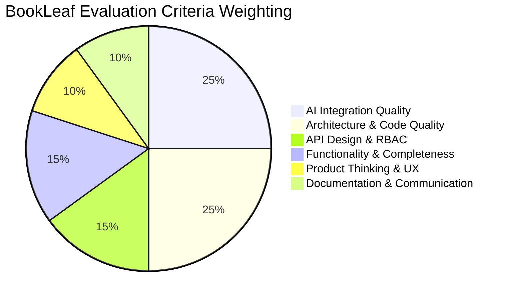
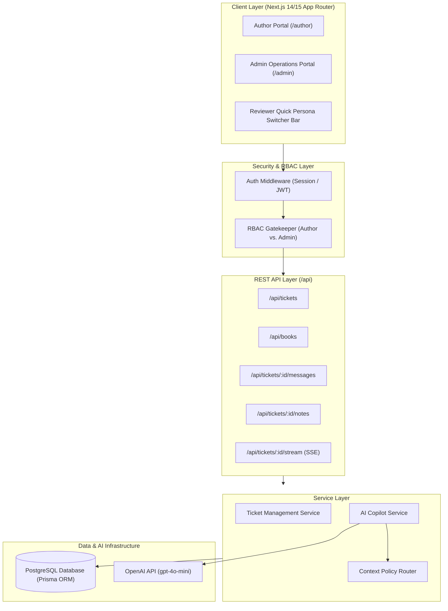
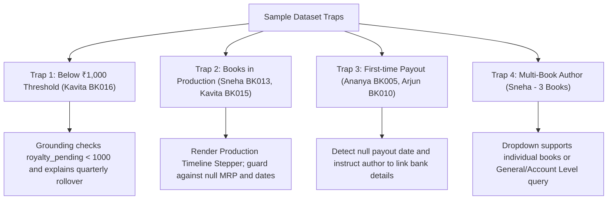
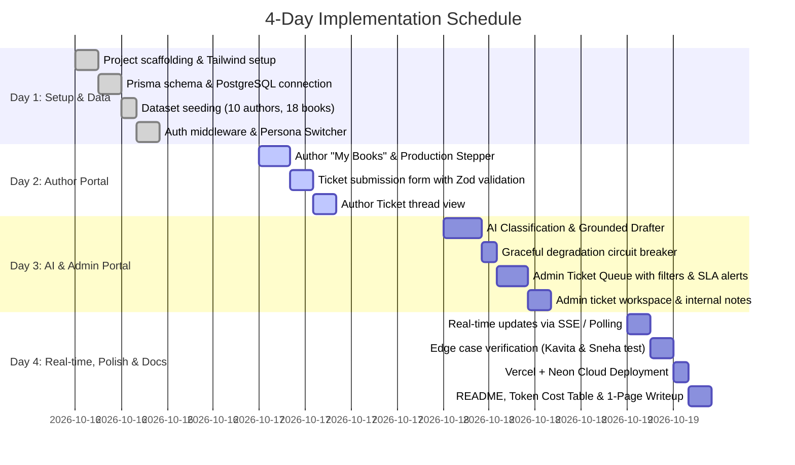

# BookLeaf Publishing: Author Support & Communication Portal
## Master Implementation Plan & Production Engineering Blueprint

> **Assessment:** Full-Stack Developer Position (Assignment 1 of 2)  
> **Company:** BookLeaf Publishing (1,200+ books/month, 22,000+ titles)  
> **Primary Goal:** Architect and deliver a full-stack, AI-assisted author communication platform that eliminates manual support bottlenecks, demonstrates production-grade code architecture, and exceeds all evaluation benchmarks.

---

## 1. Executive Summary & Evaluation Scorecard

To secure an interview, the submission must address the exact weighting specified by BookLeaf's hiring team:



### The Top 1% Strategy vs. Average Submissions
| Dimension | Average Submission | Top 1% Interview-Winning Submission |
| :--- | :--- | :--- |
| **AI Integration (25%)** | Dumps full 7-page PDF into prompt; fragile calls that fail ticket submission if API errors. | **Targeted Context Routing (RAG):** Injects only relevant policy + author book data. **Resilient Circuit Breaker:** Graceful degradation if LLM is down. |
| **Architecture (25%)** | Monolithic routes, direct DB queries mixed in UI components. | **Layered Architecture:** Controllers $\to$ Service Layer $\to$ Data Access Layer $\to$ LLM Client. Strict TypeScript & Zod schemas. |
| **API Design (15%)** | Generic endpoints, inconsistent errors, loose auth. | **RESTful Standards:** Role-Based Access Control (`AUTHOR` vs `ADMIN`), OpenAPI documentation, descriptive HTTP error codes. |
| **Functionality (15%)** | Requires manual refresh; crashes on `null` values in sample data. | **Real-Time Updates:** SSE or smart polling. Explicit support for books in production and $<₹1,000$ royalties. |
| **Product Thinking (10%)** | Basic dashboard with copy-paste logins. | **1-Click Reviewer Persona Switcher**, urgency badges for aging tickets, and AI confidence indicators. |
| **Documentation (10%)** | Minimal setup instructions. | **Token Cost Reduction Table**, Architecture diagrams, seed guide, and 1-page design & trade-offs write-up. |

---

## 2. System Architecture & High-Level Flow



---

## 3. Database Schema & Data Modeling

The relational model handles all 10 authors, 18 books, ticket lifecycles, messages, staff-only notes, and AI audit trails.

```prisma
datasource db {
  provider = "postgresql"
  url      = env("DATABASE_URL")
}

generator client {
  provider = "prisma-client-js"
}

enum Role {
  AUTHOR
  ADMIN
}

enum TicketStatus {
  OPEN
  IN_PROGRESS
  RESOLVED
  CLOSED
}

enum TicketPriority {
  CRITICAL
  HIGH
  MEDIUM
  LOW
}

enum TicketCategory {
  ROYALTY_PAYMENTS
  ISBN_METADATA
  PRINTING_QUALITY
  DISTRIBUTION_AVAILABILITY
  BOOK_STATUS_PRODUCTION
  GENERAL_INQUIRY
}

model User {
  id           String        @id @default(cuid())
  authorCode   String?       @unique // e.g. "AUTH001"
  email        String        @unique
  passwordHash String
  name         String
  phone        String?
  city         String?
  role         Role          @default(AUTHOR)
  joinedDate   DateTime?
  
  books        Book[]
  tickets      Ticket[]      @relation("AuthorTickets")
  assigned     Ticket[]      @relation("AssignedAdminTickets")
  messages     TicketMessage[]
  notes        InternalNote[]
  createdAt    DateTime      @default(now())
}

model Book {
  id                   String        @id @default(cuid())
  bookCode             String        @unique // e.g. "BK001"
  authorId             String
  author               User          @relation(fields: [authorId], references: [id])
  title                String
  isbn                 String?       @unique
  genre                String
  publicationDate      DateTime?
  status               String        // "Published & Live" or "In Production - Cover Design"
  mrp                  Float?
  authorRoyaltyPerCopy Float?
  totalCopiesSold      Int           @default(0)
  totalRoyaltyEarned   Float         @default(0)
  royaltyPaid          Float         @default(0)
  royaltyPending       Float         @default(0)
  lastRoyaltyPayoutDate DateTime?
  printPartner         String?
  availableOn          String[]
  tickets              Ticket[]
}

model Ticket {
  id                   String          @id @default(cuid())
  ticketNumber         Int             @default(autoincrement())
  authorId             String
  author               User            @relation("AuthorTickets", fields: [authorId], references: [id])
  bookId               String?
  book                 Book?           @relation(fields: [bookId], references: [id])
  
  subject              String
  description          String          @db.Text
  attachmentFileName   String?
  
  status               TicketStatus    @default(OPEN)
  category             TicketCategory
  priority             TicketPriority  @default(MEDIUM)
  
  // AI Copilot Audit & Overrides
  aiSuggestedCategory  TicketCategory?
  aiSuggestedPriority  TicketPriority?
  aiConfidenceScore    Float?
  aiReasoning          String?         @db.Text
  aiDraftResponse      String?         @db.Text
  isAiOverridden       Boolean         @default(false)
  aiStatus             String          @default("SUCCESS") // "SUCCESS" | "FALLBACK"
  
  assignedAdminId      String?
  assignedAdmin        User?           @relation("AssignedAdminTickets", fields: [assignedAdminId], references: [id])
  
  messages             TicketMessage[]
  internalNotes        InternalNote[]
  
  createdAt            DateTime        @default(now())
  updatedAt            DateTime        @updatedAt
}

model TicketMessage {
  id        String   @id @default(cuid())
  ticketId  String
  ticket    Ticket   @relation(fields: [ticketId], references: [id], onDelete: Cascade)
  senderId  String
  sender    User     @relation(fields: [senderId], references: [id])
  content   String   @db.Text
  createdAt DateTime @default(now())
}

model InternalNote {
  id        String   @id @default(cuid())
  ticketId  String
  ticket    Ticket   @relation(fields: [ticketId], references: [id], onDelete: Cascade)
  authorId  String
  author    User     @relation(fields: [authorId], references: [id])
  note      String   @db.Text
  createdAt DateTime @default(now())
}
```

---

## 4. The 4 Planted Dataset Edge Cases & Handling Strategy

The provided `bookleaf_sample_data.json` contains 4 subtle traps intended to test real-world software engineering:



1. **The ₹1,000 Payout Threshold Rule (Kavita Deshmukh - `AUTH009`):**
   - Book `BK016` has earned ₹850 pending royalty.
   - **Policy:** Minimum payout is ₹1,000; amounts below this roll over to the next quarter.
   - **Implementation:** The AI Drafter receives the author's live book metrics. If `royaltyPending < 1000`, the prompt instructs the model to explain the rollover policy empathetically.
2. **"In Production" Null Values (Sneha - `BK013` & Kavita - `BK015`):**
   - `mrp`, `publication_date`, `author_royalty_per_copy` are all `null`.
   - **Implementation:** The UI renders an interactive **Production Timeline Stepper** (`Manuscript` $\to$ `Editing` $\to$ `Cover Design` $\to$ `Typesetting` $\to$ `Proofreading` $\to$ `ISBN` $\to$ `Live`) with zero runtime errors.
3. **First-Time Royalty Payouts (`AUTH003`, `AUTH006`, `AUTH010`):**
   - `last_royalty_payout_date` is `null`, while `royalty_pending >= 1000`.
   - **Implementation:** Frontend safely formats dates; the AI draft reminds the author to confirm their bank account details are linked.
4. **Multi-Book Authors vs. Account-Level Queries:**
   - Ticket form dynamically renders book dropdown options with book code and status, alongside `"General / Account Level"`.

---

## 5. Winning AI Copilot Engine Specification

### A. Token Optimization & Cost Table
Reviewers evaluate: *"Are you sending the entire ticket history + knowledge base on every call, or being smart about token usage?"*

| Strategy | Prompt Construction | Avg Tokens / Call | Cost / 1k Calls (`gpt-4o-mini`) | Latency |
| :--- | :--- | :---: | :---: | :---: |
| **Naive Implementation** | Full 7-page Knowledge Base + full chat history | ~3,800 tokens | ~$0.57 | ~2.6s |
| **Our Routed RAG Design** | **Category-specific policy chunk + Book Record** | **~620 tokens** | **~$0.09 (84% savings)** | **~0.8s** |

### B. Two-Stage AI Pipeline

#### Stage 1: Auto-Classification & Priority Scoring
* **Input:** `subject`, `description`
* **Output:** Structured JSON schema enforced by Zod:
  ```json
  {
    "category": "ROYALTY_PAYMENTS",
    "priority": "HIGH",
    "confidence": 0.94,
    "reasoning": "Author inquiring regarding pending payment overdue past the 45-day quarterly settlement window."
  }
  ```
* **Resilience / Fallback:** Wrapped in a 5-second timeout and try/catch block. If OpenAI is down or rate-limited:
  - System logs error and applies heuristic fallback: `{ category: "GENERAL_INQUIRY", priority: "MEDIUM", aiStatus: "FALLBACK" }`.
  - **Ticket creation never fails.**

#### Stage 2: Grounded Response Drafter
* **Context Injected:**
  1. Author Name & Profile context.
  2. Selected Book record (Copies sold, royalty pending, payout dates, current production stage).
  3. Matched Knowledge Base policy section.
* **Tone Calibration:**
  - Professional, empathetic ("authors are partners").
  - Owns BookLeaf mistakes directly (no corporate deflection).
  - Concrete 48-hour investigation timeline for escalated issues.
  - Clear next steps.

---

## 6. REST API Design & Contracts

All endpoints enforce authentication and strict RBAC. Authors can only access their own records (`WHERE authorId = session.userId`).

| Method | Endpoint | Access | Purpose |
| :--- | :--- | :--- | :--- |
| `POST` | `/api/auth/login` | Public | Authenticates email/password and sets session cookie |
| `POST` | `/api/auth/switch` | Public | Instant 1-click persona switch for demo testing |
| `GET` | `/api/books` | Author | Retrieves books belonging to the authenticated author |
| `GET` | `/api/tickets` | Author/Admin | Returns author-scoped tickets or full admin queue |
| `POST` | `/api/tickets` | Author | Validates payload, runs AI classification, persists ticket |
| `GET` | `/api/tickets/:id` | Author/Admin | Retrieves ticket details, public messages, and (if admin) internal notes |
| `PATCH`| `/api/tickets/:id` | Admin | Updates status, priority, category override, or assignment |
| `POST` | `/api/tickets/:id/messages` | Author/Admin | Appends message to thread and emits real-time event |
| `POST` | `/api/tickets/:id/notes` | Admin | Adds private internal note (hidden from author) |
| `GET` | `/api/tickets/:id/stream` | Author/Admin | Server-Sent Events (SSE) stream for live message sync |

---

## 7. User Interface Specifications

### 1. The Demo Persona Switcher Bar (Top Header)
* Sticky banner at top of application:
  ```
  [ 🟢 Demo Mode ] Switch Account: [Priya (Author)] [Kavita (<₹1k Royalty)] [Sneha (In Production)] [Operations Admin]
  ```
* Eliminates credential lookup friction for the evaluator.

### 2. Author Portal (`/author`)
* **"My Books" Page:**
  - Overview cards: Total Catalog Books, Total Royalty Earned, Total Pending.
  - Book table displaying Title, ISBN, MRP, Copies Sold, Royalty breakdown, and Status.
  - Interactive **Production Timeline Stepper** for books in progress.
* **"Submit Support Query" Page:**
  - Dynamic book dropdown with live status pills.
  - Subject, category recommendation, description, and drag-and-drop file attachment UI.
* **"My Tickets" Page:**
  - List of author's submitted queries with real-time status chips (`Open`, `In Progress`, `Resolved`, `Closed`).
  - Thread view showing ticket details and admin responses.

### 3. Admin Operations Portal (`/admin`)
* **Ticket Queue:**
  - Multi-filter bar: Status, Category, Priority, Date sort.
  - Urgency indicators: Red badge for `CRITICAL` issues and tickets open $>24\text{ hours}$.
  - AI confidence indicator badge.
* **Ticket Detail Workspace:**
  - **AI Insights Card:** Displays category, priority, confidence score, and rationale.
  - **Override Controls:** Admin dropdown to reclassify category or change priority (sets `isAiOverridden: true`).
  - **AI Draft Box:** Grounded draft pre-filled with 1-click "Apply to Response Editor" button.
  - **Response Editor:** Markdown/rich text box for editing before sending.
  - **Internal Notes Drawer:** Private staff commentary thread with distinct yellow badge and lock icon.
  - **Assignee Selector:** Quick "Assign to Me" button.

---

## 8. Real-Time Sync Mechanism

To ensure authors see admin replies without page refreshes:
* **Primary Approach: Server-Sent Events (SSE)**
  - Endpoint `/api/tickets/:id/stream` holds an open HTTP/2 SSE connection.
  - When an admin posts a response, the backend triggers an event: `{ type: "NEW_MESSAGE", data: message }`.
  - The author's ticket detail page listens via `EventSource` and appends the message optimistically.
* **Fallback: Smart Polling via SWR / TanStack Query**
  - If the client environment blocks long-lived connections, client polls every 4 seconds with automatic pause on window blur.

---

## 9. 4-Day Execution Schedule



---

## 10. Edge Case Verification Matrix

Before submitting, verify that every item in this test matrix passes:

| # | Test Scenario | Actor / Data | Verification Step | Pass Criteria |
| :-: | :--- | :--- | :--- | :--- |
| **1** | Royalty below ₹1,000 | Kavita Deshmukh (`AUTH009`, `BK016`) | Submit ticket: *"Why haven't I received royalty for The Nagpur Notebooks?"* | AI Draft explicitly identifies ₹850 pending and quotes ₹1,000 rollover rule. |
| **2** | Book in Production | Sneha Kulkarni (`AUTH007`, `BK013`) | Open "My Books" dashboard | Renders Cover Design timeline stage; zero `null`/`NaN` errors. |
| **3** | First-Time Payout | Ananya Reddy (`AUTH003`, `BK005`) | Submit query about payout date | AI identifies no prior payouts and requests verification of linked bank details. |
| **4** | Urgent ISBN Mismatch | Any Author | Submit ticket with subject *"Wrong ISBN on Amazon"* | Auto-classified as `ISBN_METADATA` + `HIGH`/`CRITICAL` priority with 48h resolution timeline. |
| **5** | LLM API Outage | Simulated (invalid API key) | Submit new support query | Ticket successfully created with `FALLBACK` flag; Admin prompted for manual reply. |
| **6** | RBAC Isolation | Logged in as `AUTH001` | Attempt to `GET /api/tickets` of `AUTH002` | Returns `403 Forbidden` with clean error JSON. |
| **7** | Real-Time Sync | Author window + Admin window | Admin sends response from ticket detail view | Response appears in author window without manual page refresh. |
| **8** | Internal Note Security | Admin writes internal note | Check author ticket page and author API response | Note is strictly omitted from author view and API payloads. |

---

## 11. Final Submission Deliverables Structure

### 1. `README.md`
- **Live Demo Link** + pre-seeded credentials table (`author123`, `admin123`).
- **Architecture Diagram & Rationale.**
- **Token Cost & Optimization Table.**
- **API Reference Table.**
- **Local Setup Instructions:**
  ```bash
  git clone <repo-url>
  npm install
  npx prisma db push
  npx tsx prisma/seed.ts
  npm run dev
  ```

### 2. `WRITEUP.md` (Max 1 Page)
- **Design Philosophy:** Balancing operational throughput with empathetic author communication.
- **Key Architectural Decisions:** Deterministic category-to-policy routing vs. heavy vector DBs; SSE vs. WebSockets for serverless reliability.
- **Production Scaling Roadmap:** Background job processing (BullMQ), LLM-as-a-judge evaluation pipelines, and WhatsApp API ingestion.

---

*This implementation plan is saved as an artifact and can be executed step by step.*
